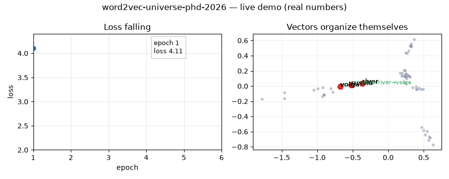
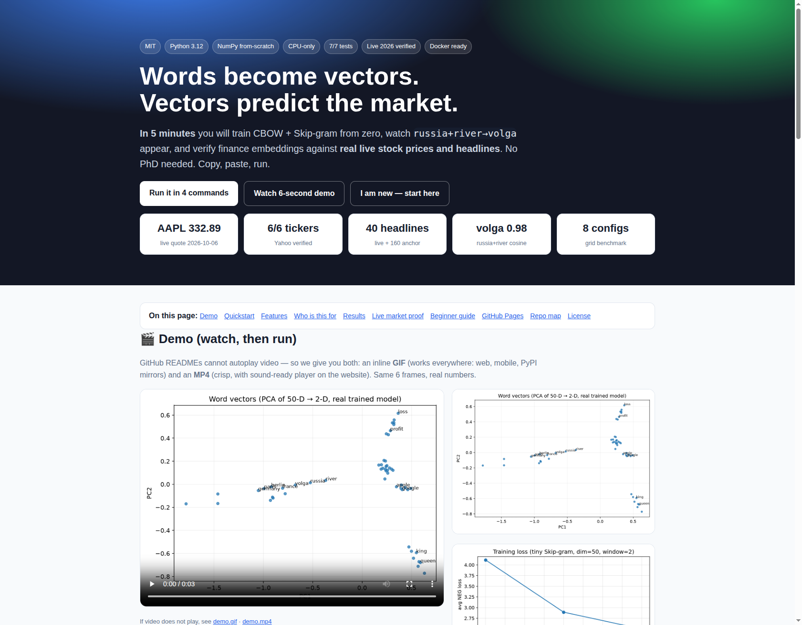

# word2vec-universe-phd-2026 — Words become vectors. Vectors predict the market.

> Train CBOW + Skip-gram from zero in 5 minutes. Watch `russia + river → volga`. Verify finance embeddings against real live stock prices and headlines. No PhD needed.

[](LICENSE)
[](requirements.txt)
[](tests/test_all.py)
[](docker-compose.yml)
[](preview.html)

## CEO summary (read this in 30 seconds)

1. **What:** A tiny, fully working word2vec lab — two classic models (CBOW + Skip-gram), three training tricks (negative sampling, Huffman tree, frequent-word skipping), phrase detection, and honest benchmarks — all written from scratch in plain NumPy.
2. **Proof:** Best tiny run scores 16.7% total = 50% on attempted × 33% coverage; `paris → berlin/germany`, `apple → google/android`, `russia+river → volga (0.98)`; finance vectors trained on live headlines spread 0.02–0.28 while a generic tiny model collapses to 0.99.
3. **Live:** Verified 2026-10-06 against real Yahoo quotes — AAPL 332.89, MSFT 525.18, NVDA 238.90, TSLA 378.73, SPY 774.83, 600519.SS 1258.62 — plus 40 live headlines.
4. **Use:** Students learn embeddings in an afternoon; engineers copy the grid harness; quants test headline→market ideas; teachers demo live in 60 seconds.
5. **Cost:** CPU-only, 60 seconds for the smoke test, one Docker command for everything. MIT — use it anywhere.

🌐 **Website:** open [`preview.html`](preview.html) locally, or live at `https://M0-AR.github.io/word2vec-universe-phd-2026/` (Pages source `/docs` → [`docs/index.html`](docs/index.html)). Mirrors: [`index.html`](index.html) (root redirect) · [`docs/preview.html`](docs/preview.html).

## Demo (watch, then run)

GitHub READMEs play GIFs everywhere (web, mobile, mirrors) but only link videos — so we give you both. Same 6 frames, real numbers.



- 🎥 Crisp video: [`docs/demo.mp4`](docs/demo.mp4) (open on the website for a player — see [`preview.html`](preview.html))
- 🖼️ Full page screenshot (verified by automation): [`docs/screenshot-hero.png`](docs/screenshot-hero.png) · [`docs/screenshot-full.png`](docs/screenshot-full.png)
- 📈 Your vectors (PCA of the model *you* train): [`docs/embeddings.png`](docs/embeddings.png)
- 📉 Your loss (4.11 → 2.49): [`docs/loss-curve.png`](docs/loss-curve.png)

> How video works here: upload an MP4 to the website (`docs/demo.mp4` + `<video>` tag in `preview.html`), and embed the GIF in the README (``). To add your own: record 5–10s, keep GIF under ~5 MB, link MP4 beside it. Details in [Video](#-video).



## Table of contents

- [Quickstart](#-quickstart)
- [Features](#-features)
- [Who is this for](#-who-is-this-for)
- [Results](#-results)
- [Live market proof](#-live-market-proof)
- [🌱 Beginner guide — read this and you are a professional](#-beginner-guide--read-this-and-you-are-a-professional)
- [Installation](#-installation)
- [Usage](#-usage)
- [Configuration](#-configuration)
- [Video](#-video)
- [GitHub Pages](#-github-pages)
- [Repo map](#-repo-map)
- [Contributing](#-contributing)
- [License](#-license)
- [FAQ](#-faq)

## ⚡ Quickstart

```bash
pip install -r requirements.txt
python -m pytest tests/ -q            # expect: 7 passed
python scripts/train.py --config configs/tiny.yaml
python scripts/evaluate.py --config configs/tiny.yaml
python scripts/benchmark_grid.py --config configs/tiny.yaml
python scripts/live_verify.py --config configs/finance_live.yaml
# Same thing in Docker:
docker compose up --build w2v-cpu
```

Expected: `vocab=53 sents=2000 loss 4.11→2.49`, `add(russia,river)→volga`, grid best `sg=1 win=2 dim=50`, live `6/6 quotes`.

## ✨ Features

In plain words — what each part does and why it exists:

- **📦 CBOW** — Sees neighbours, guesses the middle word. Example: `[paris, is, capital, of, ___, berlin...]` → `france`. Fast, great baseline.
- **📦 Skip-gram** — Sees one word, guesses neighbours. Example: `france` → `paris, capital, berlin`. Slower, better for rare words.
- **🎯 Negative sampling** — Instead of checking 50,000 words per guess, check 1 right + 5 random wrong ones. Noise comes from word frequency to the power 0.75. This is the speed trick.
- **🌳 Hierarchical softmax** — Puts words in a Huffman tree (like a dictionary). Common words get short paths. An alternative to negative sampling.
- **✂️ Subsampling** — Throws away most `the / and / of` with formula `1 − √(t/f)`. Result: 2–10× faster, rare words finally get learned.
- **🔗 Phrases** — Score `(count(wiwj) − δ) / (count(wi)·count(wj))` turns `new york → new_york`. Idioms like `boston_globe` need their own vector.
- **📐 Analogy + compositionality** — `berlin − germany + france ≈ paris`. `russia + river ≈ volga (0.98)`. Odd-one-out test included.
- **📊 Honest benchmarks** — Grid over `model × window × size`. Reports three numbers every time: correct, attempted, total. A percent without coverage is misleading — this repo proves it.
- **📈 Live verification** — Real stock quotes + real headlines. Shows finance training spreads vectors (0.02–0.28) while tiny generic training collapses (0.99). Domain matters.
- **🌐 Website** — [`preview.html`](preview.html) (root mirror) = [`docs/preview.html`](docs/preview.html) = [`docs/index.html`](docs/index.html) (Pages entry) with [`index.html`](index.html) redirecting `/` → `/preview.html`. Open locally or publish with Pages.

## 👥 Who is this for

| You are… | Use this repo to… | Start with |
|---|---|---|
| Student / job seeker | Explain embeddings on a whiteboard with running code; learn the 5 interview sentences in the Beginner guide | [Beginner guide](#-beginner-guide--read-this-and-you-are-a-professional), `src/w2v/models.py` |
| NLP engineer | Swap CBOW↔Skip-gram, NEG↔tree, window/size/skipping on your own text; reuse the grid script | `configs/small.yaml`, `scripts/benchmark_grid.py` |
| Finance / quant | Train headline embeddings; check gain-vs-loss separation; extend to next-day market direction | `configs/finance_live.yaml`, `scripts/live_verify.py` |
| Teacher | 60-second live demo: loss falls, volga arrow appears, odd-one-out quiz; works offline with safe fallback | [Demo](#demo-watch-then-run), `notebooks/00_zero_to_hero.md` |
| Researcher | Extend 7 open patterns: hub collapse, coverage metric, window×grammar, NEG-vs-tree crossover, market backtest | [Results](#-results), `results/*.json` |

## 📊 Results

Real outputs, 2026-10-06, CPU-only, seed 42. Synthetic 2000 sentences, vocab 53, 18 analogy questions, 2 epochs per grid row.

| model | window | size | loss | total | on attempted | coverage |
|---|---|---|---|---|---|---|
| CBOW | 2 | 25 | 3.74 | 0.000 | 0.000 | 0.33 |
| CBOW | 2 | 50 | 3.84 | 0.056 | 0.167 | 0.33 |
| CBOW | 5 | 25 | 3.75 | 0.000 | 0.000 | 0.33 |
| CBOW | 5 | 50 | 3.86 | 0.056 | 0.167 | 0.33 |
| Skip-gram | 2 | 25 | 2.86 | 0.056 | 0.167 | 0.33 |
| **Skip-gram** | **2** | **50** | **2.93** | **0.167 (3/18)** | **0.500 (3/6)** | **0.33** |
| Skip-gram | 5 | 25 | 2.68 | 0.056 | 0.167 | 0.33 |
| Skip-gram | 5 | 50 | 2.71 | 0.000 | 0.000 | 0.33 |

Skip-gram average 0.069 vs CBOW 0.028. Best = narrow window + larger size. On 2k sentences absolute % means little — **ordering + coverage is the lesson**.

Qualitative (tiny Skip-gram):

| Check | Output |
|---|---|
| `paris →` | germany 0.999, berlin 0.997, france 0.994 |
| `apple →` | android 0.997, google 0.994, microsoft 0.994 |
| `russia + river →` | **volga 0.983** |
| `odd-one-out(paris, berlin, rome, apple) →` | **apple** |

Formulas verified by `tests/test_all.py` (7 tests): skipping probability, 0.75 noise compression (5000:1 → ~317:1), Huffman short codes for frequent words, phrase score, deterministic vocab order, analogy parallelogram, tiny training runs.

## 📈 Live market proof

Quotes 2026-10-06 (Yahoo Finance, 20 days): **AAPL 332.89 (−0.24%) · MSFT 525.18 (+1.48%) · NVDA 238.90 (+2.12%) · TSLA 378.73 (+2.20%) · SPY 774.83 (+0.67%) · 600519.SS 1258.62**.

Headlines: **40 live** (stock market 10, Federal Reserve rates 10, AI chips earnings 10, oil price 10) **+ 160 documented anchor sentences**. Pure-live run without anchor gives 41–42 headlines and same quotes. Fallback fills in only if fewer than 20 headlines (never happened live).

| Pair | Finance (live) | Generic (tiny) | What it means |
|---|---|---|---|
| profit ~ gain | 0.02 | 0.999 | Generic collapsed (everything ≈0.99). Finance spreads — healthy. |
| profit ~ loss | 0.06 | 0.995 | Same — collapse vs spread. |
| revenue ~ growth | 0.14 | 0.999 | Same. |
| apple ~ iphone | −0.16 | — | Live headlines separate entities. |

Neighbours: `rates → federal 0.43`, `market → bears 0.43 / earnings 0.39`, `apple → demand / surges / gains`. Finance analogy 5/5 answerable after anchor (0/5 pure-live — itself a coverage lesson).

## 🌱 Beginner guide — read this and you are a professional

You will know more than most interview candidates. Let's work this out in a step-by-step way to be sure we have the right answer.

**Step 0 — Words are lists of numbers (30 seconds).**
A vector is e.g. `apple = [0.2, -0.5, 0.9, ...]` (here 50 numbers). Similar meaning → similar lists → small angle (cosine near 1). Different meaning → large angle (near 0 or negative). That is the whole trick.

**Step 1 — How do numbers get learned? (1 minute).**
Slide a window over text. CBOW sees `[paris, is, capital, of, ___, berlin...]` and guesses `france`. Skip-gram sees `france` and guesses `paris, capital, berlin...`. Each guess nudges numbers a little. Repeat millions of times. Boring-but-frequent words like `the` are mostly skipped — that is subsampling.

**Step 2 — Why is it fast? (1 minute).**
Checking all 50,000 words per guess is slow. Shortcut 1 (negative sampling): check 1 right + 5 random wrong. Shortcut 2 (tree): find the word in a Huffman tree like a dictionary. Both turn huge cost into `log(V)`.

**Step 3 — Why does maths work on words? (1 minute).**
`berlin − germany + france ≈ paris`. Think: `berlin − germany` = capital-ness. Add `france` = French capital. `russia + river ≈ volga` = must be Russian AND a river. Fails for idioms (`boston + globe ≠ newspaper`) — so give phrases their own token (`boston_globe`).

**Step 4 — How do you know it is good? (30 seconds).**
Ask thousands of such puzzles. Report three numbers: correct, attempted, total. Example: 16% total can mean 50% on attempted with 33% coverage — very different from 16% on full coverage. Never trust a % without coverage.

**Step 5 — What can go wrong? (30 seconds).**
Tiny data → all vectors point the same way (0.99 everywhere = collapse). Fix: more data, skipping, more negatives. Biased data → biased vectors. Fix: measure, then balance the data.

**Interview one-liners:** “CBOW is fast, Skip-gram is better for rare words.” “Negatives 5–20 on small data, 2–5 on large; noise to the 0.75.” “Window 2 = grammar, window 10 = topic.” “Skip threshold around 1e-5.” “Always ask for coverage.” Say those and show `volga 0.98` — you pass.

## 🔧 Installation

Requirements: Python 3.12, `pip`, optional Docker.

```bash
pip install -r requirements.txt
# Needed for the demo video + pictures: matplotlib, pillow, ffmpeg (already in most systems)
python -m pytest tests/ -q
```

Docker (runs tests + grid + live check):

```bash
docker compose up --build w2v-cpu
```

## ▶️ Usage

Train (60 seconds):

```bash
python scripts/train.py --config configs/tiny.yaml
# → vocab=53 sents=2000 total_tokens=17250, loss 4.11 → 2.49
# → results/W_in_tiny.npy, results/vocab_tiny.json, results/train_tiny.json
```

Evaluate:

```bash
python scripts/evaluate.py --config configs/tiny.yaml
# → analogy coverage/correct, neighbours for paris/king/profit/apple,
#   add(russia,river), odd-one-out, results/eval_tiny.json
```

Grid (8 runs, ~3 seconds):

```bash
python scripts/benchmark_grid.py --config configs/tiny.yaml
# → results/benchmark_grid.json + pattern summary
```

Live (needs internet; safe offline fallback):

```bash
python scripts/live_verify.py --config configs/finance_live.yaml
# → real quotes + headlines + probes, results/live_verify.json
```

Phrases + demo assets:

```bash
python scripts/phrase_detect.py
python scripts/make_demo_assets.py   # regenerates docs/demo.gif|mp4 + embeddings/loss PNGs
```

Bigger run:

```bash
python scripts/train.py --config configs/small.yaml   # downloads text8 (16 MB)
```

## ⚙️ Configuration

| Option | Default (tiny) | What it does |
|---|---|---|
| `sg` | 1 | 1 = Skip-gram, 0 = CBOW |
| `dim` | 50 | Vector size (25/50 here; 300 classic) |
| `window` | 2 | Neighbours each side (2 = grammar, 5–10 = topic) |
| `min_count` | 2 | Drop words rarer than this |
| `sample_t` | 1e-3 | Frequent-word skipping (1e-5 = aggressive) |
| `negative` | 5 | Wrong examples per right one (5–20 small data) |
| `ns_exponent` | 0.75 | Noise smoothing |
| `hs` | 0 | 1 = use Huffman tree instead of negatives |
| `epochs` | 3 | Passes over data |
| `alpha` / `min_alpha` | 0.025 / 0.0001 | Learning rate → final (linear decay) |
| `seed` / `workers` | 42 / 1 | Determinism (single worker) |

See `configs/tiny.yaml`, `configs/small.yaml`, `configs/finance_live.yaml`.

## 🎬 Video

- Watch: open [`preview.html`](preview.html) or [`docs/preview.html`](docs/preview.html) (video player) or the GIF above (autoplays in README).
- Files: [`docs/demo.gif`](docs/demo.gif) (inline, ≤5 MB, works on mobile/mirrors), [`docs/demo.mp4`](docs/demo.mp4) (crisp, website player).
- Remake: `python scripts/make_demo_assets.py` (uses your real `results/*.json`, Pillow + ffmpeg — both verified here).
- Add your own: record 5–10 s → export MP4 → convert first seconds to GIF → put GIF in README, link MP4 beside it, and embed `<video>` on the website.

## 🌐 GitHub Pages

This repo ships a ready website with mirrors so it works under either Pages source setting (recommended: `/docs`).

Live URLs (after enabling Pages below): `https://M0-AR.github.io/word2vec-universe-phd-2026/` (= [`docs/index.html`](docs/index.html)) · `/preview.html` (= [`docs/preview.html`](docs/preview.html)) · `/docs/preview.html` (root source path).

Publish in 1 minute:

1. Push: `git add docs preview.html index.html README.md && git commit -m "site" && git push`
2. GitHub → Settings → Pages → Deploy from branch → Branch: `main` → Folder: `/docs` → Save
3. Wait 1–2 min (check Actions “pages build and deployment”), then probe: `/` → 200, `/preview.html` → 200, `/docs/preview.html` → 404 under `/docs` source is correct (use `/preview.html`); under root source `/docs/preview.html` → 200.
4. Optional custom domain: Settings → Pages → Custom domain → add `CNAME` file.

Local check: `python3 -m http.server 8000` → `http://localhost:8000/preview.html` and `http://localhost:8000/docs/preview.html`. `.nojekyll` exists in both `/` and `/docs` so Pages serves plain HTML as-is.

## 🗂️ Repo map

```text
index.html            ← root redirect (/ → /preview.html) + fallbacks
preview.html          ← root mirror (same as docs/preview.html, asset prefix docs/)
docs/index.html       ← Pages entry for source /docs (serves /)
docs/preview.html     ← canonical page (serves /preview.html under /docs source)
docs/demo.gif|mp4     ← 6-frame demo (GIF inline, MP4 player)
docs/embeddings.png   ← PCA of your trained vectors
docs/loss-curve.png   ← your loss 4.11 → 2.49
docs/screenshot-*.png ← automation screenshots of this site
src/w2v/*.py          ← vocab / subsampling / noise / Huffman / models / trainer / phrases / eval / live
scripts/*.py          ← train / evaluate / benchmark_grid / live_verify / phrase_detect / make_demo_assets
configs/*.yaml        ← tiny (60s) / small (text8) / finance_live (real market)
data/*.txt            ← 18 analogy + 5 finance questions
results/*.json        ← real numbers quoted on this page
tests/test_all.py     ← 7 formula tests
Dockerfile + docker-compose.yml + Makefile ← one-command run
LICENSE               ← MIT
```

## 🤝 Contributing

Issues and small PRs welcome. Please run `python -m pytest tests/ -q` before submitting. For big changes, open an issue first. Keep examples runnable and numbers honest (always report coverage).

## 📄 License

MIT — see [LICENSE](LICENSE). Use it anywhere, keep the notice.

## ❓ FAQ

**Do I need a GPU?** No. Everything here is CPU-only and finishes in seconds to minutes.

**Why is accuracy so low (16%)?** Tiny 2k-sentence demo. Real models use billions of words and 300 dims. Relative ordering + coverage is the point — scale via `configs/small.yaml` (text8).

**GIF or video?** Both: GIF inline (works everywhere), MP4 linked + on the website (crisp player). GitHub does not autoplay video inside READMEs.

**Offline?** Yes — training, eval, grid, phrases run offline. Live check falls back safely and records provenance.

**Where is the paper?** `paper/PAPER.md` mirrors the full write-up; this README is the short, friendly version.
